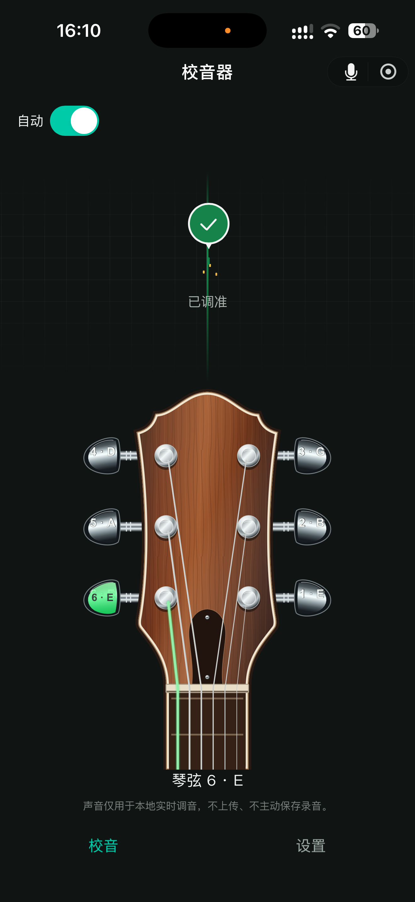
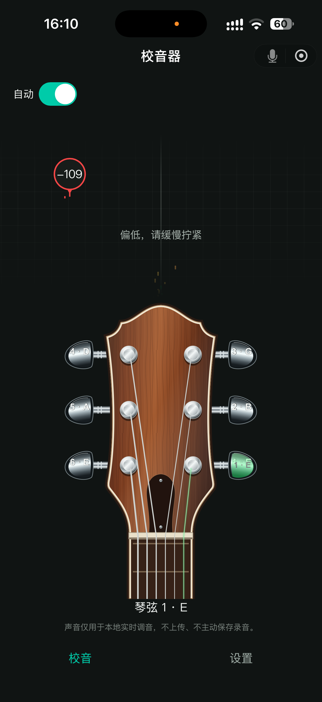

# Tuner

[简体中文](README.md) | English

A free, ad-free WeChat Mini Program for tuning guitars. It listens through your phone microphone and provides clear feedback to help you tune each string.

## Features

- Standard six-string guitar tuning: **E, A, D, G, B, E**, from string 6 to string 1.
- Automatic string identification, with manual target selection by tapping a tuning peg on the headstock.
- Flat and sharp indicators, adjustment guidance, and a checkmark and sound when a string is in tune.
- Simplified Chinese and English, following the WeChat language or your own preference.
- Local audio processing, without uploads or app-saved recordings.

## Screenshots

  
  

## How to use

Grant microphone permission and accept the usage notice, then pluck one open string at a time in a quiet environment. Follow the guidance and adjust the corresponding peg slowly. Before adjusting, check that the selected string, the string you pluck, and the tuning peg all match. The full usage notice is available in Settings.

## Project documentation

[Local development, implementation notes, and validation records](docs/product-scope.md) · [Domain terminology](CONTEXT.md) · [Development guidelines](AGENTS.md) (Chinese)

This project is licensed under the [MIT License](LICENSE).
